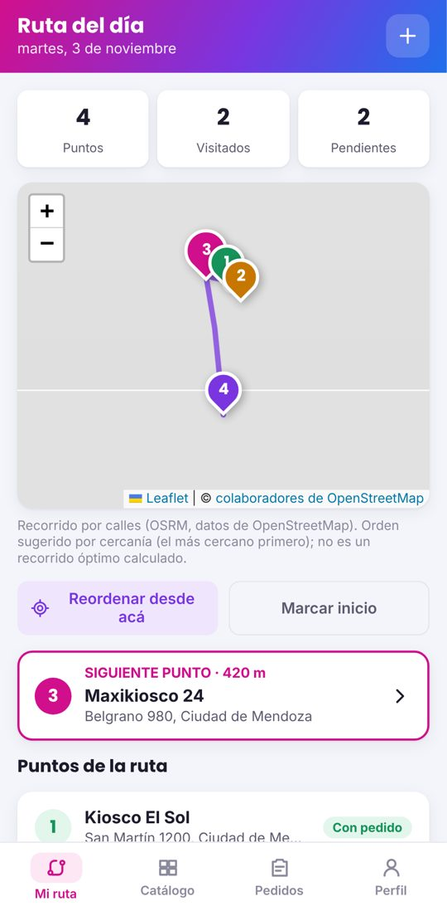
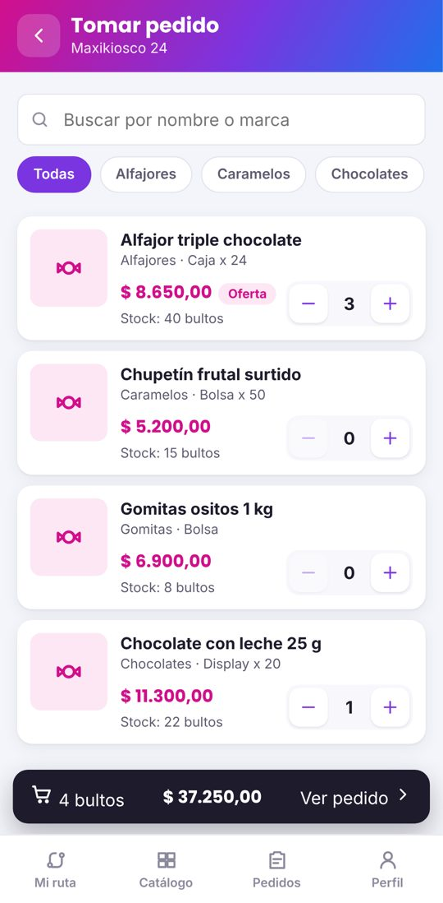
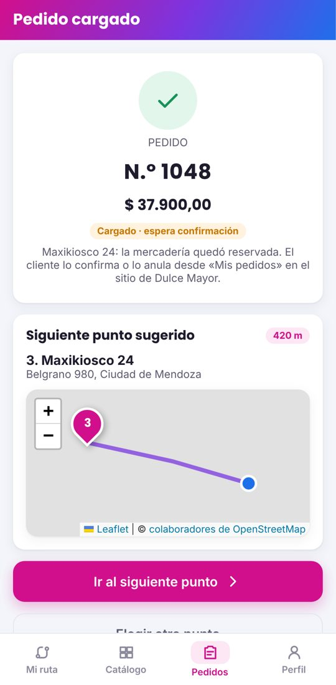
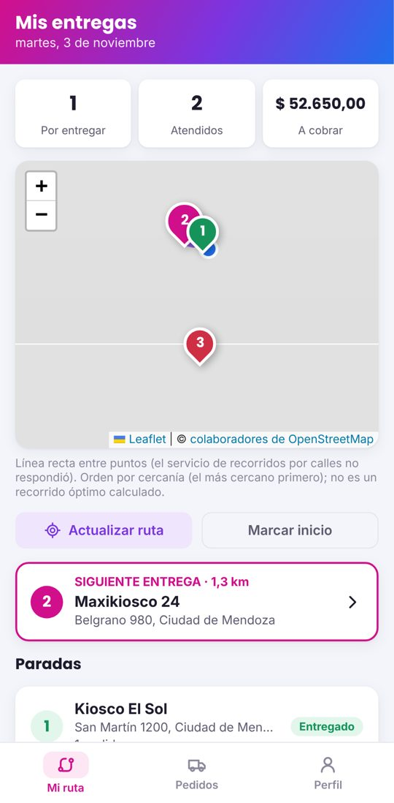

# Dulce Mayor — Ola 2: Rutas y Pedidos (documentación de la entrega anterior)

> Documento histórico de la Ola 2. Los cambios posteriores (correcciones, Facturación, motor de rutas) están en el [README principal](../README.md).

Mayorista de golosinas de Mendoza. Esta entrega agrega los módulos de **Rutas** y **Pedidos** sobre lo ya
construido (Catálogo y Stock; Personas, Usuarios, Autenticación y Autorización) y completa el flujo de punta a punta:

1. Administración arma la ruta de visitas de cada preventista.
2. El preventista, desde su celular, sigue la ruta en el mapa, da de alta comercios y carga pedidos (el stock se reserva).
3. El cliente entra al sitio, ve su pedido y lo **confirma** o lo **anula** (si lo anula, el stock vuelve al depósito).
4. Administración asigna los pedidos confirmados a un distribuidor.
5. El distribuidor arma su ruta de entregas y registra cada entrega; lo que no se pudo entregar vuelve en la ruta del día siguiente.

> La documentación de la etapa anterior (autenticación, JWT, OAuth, matriz de permisos de personas) quedó en
> [`docs/README-etapa2.md`](README-etapa2.md) y la configuración de Google/Facebook en
> [`CONFIGURACION-OAUTH.md`](../CONFIGURACION-OAUTH.md).
>
> **Importante sobre la verificación:** en el entorno donde se desarrolló no había acceso a Maven Central, así que
> **no se pudieron ejecutar** `mvnw test` ni levantar Spring Boot. Lo que sí se ejecutó y lo que falta ejecutar está
> detallado en la [sección 24](#24-qué-se-verificó-y-qué-no). Antes de la entrega hay que correr las pruebas del backend.

## Índice

1. [Funcionalidades implementadas](#1-funcionalidades-implementadas)
2. [Historias de usuario HU-15 a HU-21](#2-historias-de-usuario-hu-15-a-hu-21)
3. [HU-17 según el backlog](#3-hu-17-según-el-backlog)
4. [Módulos de Rutas y Pedidos (modelo y cambios al diagrama)](#4-módulos-de-rutas-y-pedidos)
5. [Integración con OpenStreetMap](#5-integración-con-openstreetmap)
6. [Bibliotecas y servicios externos](#6-bibliotecas-y-servicios-externos)
7. [Ubicación del usuario](#7-ubicación-del-usuario)
8. [Geocodificación](#8-geocodificación)
9. [Cálculo del recorrido](#9-cálculo-del-recorrido)
10. [Registro de visitas](#10-registro-de-visitas)
11. [Registro de pedidos](#11-registro-de-pedidos)
12. [Confirmación y cancelación por el cliente](#12-confirmación-y-cancelación-por-el-cliente)
13. [Reserva y devolución de stock](#13-reserva-y-devolución-de-stock)
14. [Inicio del proceso de pago](#14-inicio-del-proceso-de-pago)
15. [Entregas](#15-entregas)
16. [Reprogramación de entregas](#16-reprogramación-de-entregas)
17. [Alta de clientes y puntos de venta en campo](#17-alta-de-clientes-y-puntos-de-venta-en-campo)
18. [Endpoints nuevos y permisos](#18-endpoints-nuevos-y-permisos)
19. [Aplicaciones React: cómo ejecutarlas](#19-aplicaciones-react-cómo-ejecutarlas)
20. [Backend y aplicaciones web: cómo ejecutar](#20-backend-y-aplicaciones-web-cómo-ejecutar)
21. [Variables de entorno](#21-variables-de-entorno)
22. [Seguridad: propiedad de los recursos](#22-seguridad-propiedad-de-los-recursos)
23. [Funcionalidades pendientes](#23-funcionalidades-pendientes)
24. [Qué se verificó y qué no](#24-qué-se-verificó-y-qué-no)

---

## Estructura del proyecto

```
dulce-mayor/
├── backend/             API REST (Spring Boot 4.1, Java 25, JPA, Spring Security + JWT)       — puerto 8080
├── admin-web/           Sistema administrativo (Spring MVC + Thymeleaf)                       — puerto 8081
├── institucional-web/   Sitio para clientes (Spring MVC + Thymeleaf)                          — puerto 8082
├── movil/
│   ├── comun/           Código React compartido: cliente Axios, sesión, mapa, ubicación, estilos
│   ├── preventista/     App React del preventista (Vite)                                     — puerto 5173
│   └── distribuidor/    App React del distribuidor (Vite)                                    — puerto 5174
├── docs/                Documentación de la etapa 2 y capturas
├── README.md
└── CONFIGURACION-OAUTH.md
```

La arquitectura no cambia: **cliente-servidor**, **MVC**, **tres capas**, **REST** y **DTO**. Los servicios nuevos
heredan de `BaseService` (patrón **Template Method**: `crearEntidad`, `validar`, `actualizarEntidad`,
`convertirAResponse` y los ganchos `preAlta`/`postAlta`) y los controladores de `BaseController`. Los controladores no
tienen lógica ni repositorios; cada servicio usa **solo su repositorio** y llega a las demás entidades a través de
sus servicios (por ejemplo, `ServicioPedido` descuenta stock con `ServicioStock` y marca la visita con `ServicioRuta`).
Las apps React y las web Thymeleaf son clientes de la API: ninguna accede a la base.

---

## 1. Funcionalidades implementadas

| Quién | Dónde | Qué puede hacer |
|---|---|---|
| Administrativo | admin-web → **Rutas** | Ver las rutas de un día con el estado de cada punto, armar la ruta de visitas de un preventista (fecha + comercios), darla de baja si nadie la empezó. |
| Administrativo | admin-web → **Entregas** | Ver los pedidos confirmados sin distribuidor, asignarlos a un distribuidor y ver los asignados que siguen pendientes. |
| Preventista | app React (celular) | Ingresar (cambio de clave obligatorio en el primer ingreso), ver su ruta del día en el mapa y en lista, ordenarla por cercanía desde su ubicación, ver el detalle de un comercio, tomar un pedido con el catálogo (buscador, categorías, stock, precio vigente), ver el resumen y cargarlo, ver el siguiente punto sugerido, registrar una visita sin pedido con motivo, dar de alta un cliente (que escribe su correo y su contraseña) y su punto de venta con ubicación en el mapa, consultar el catálogo y sus pedidos. |
| Cliente | institucional-web → **Mis pedidos** | Ver sus pedidos y su detalle; **confirmar** o **anular** los que están en estado CARGADO. Si entra por un enlace a un pedido sin sesión, después de ingresar vuelve a ese pedido. |
| Distribuidor | app React (celular) | Ingresar, armar su ruta de entregas del día (comercios con pedidos asignados, ordenados por cercanía), ver cada parada con sus pedidos y el monto a cobrar, registrar **Entregado** o **No se pudo entregar** (con motivo), ver sus pedidos pendientes. |

Capturas (datos de ejemplo, ver sección 24) en [`docs/capturas/ola2/`](capturas/ola2/).

| Preventista: ruta | Tomar pedido | Pedido cargado | Distribuidor: entregas |
|---|---|---|---|
|  |  |  |  |

---

## 2. Historias de usuario HU-15 a HU-21

| HU | Estado | Dónde | Notas |
|---|---|---|---|
| **HU-15** Catálogo público | Implementada (etapa de Catálogo; se mantiene) | institucional-web `/catalogo`, `GET /api/catalogo` | Foto, descripción, presentación y precio vigente; filtro por categoría y buscador; los productos sin stock o sin precio vigente no se muestran. |
| **HU-16** Catálogo móvil | Implementada | App preventista → Catálogo y Tomar pedido | Buscador (con espera de 350 ms mientras se escribe), chips de categoría, precio vigente y stock disponible en bultos. Reutiliza `GET /api/catalogo` y `GET /api/categorias`. |
| **HU-17** Alta de punto de venta | Implementada según el backlog (sección 3) | App preventista → “+” en Ruta del día | |
| **HU-18** Armar ruta | Implementada | admin-web `/rutas/nueva`, `POST /api/rutas` | El administrativo elige preventista, fecha y puntos. Una ruta por preventista por día y por tipo; no se arma para fechas pasadas; el empleado tiene que ser preventista. El orden lo calcula la app desde la ubicación del preventista (“admin asigna, app ordena”). |
| **HU-19** Ver ruta en el mapa | Implementada | App preventista → Mi ruta | Mapa con pines numerados por orden y coloreados por estado, lista con el estado de cada punto y trazado del recorrido. El componente `MapaRuta` está en `movil/comun` y lo usa también la app del distribuidor. |
| **HU-20** Siguiente punto | Implementada | App preventista | Al cargar un pedido, el punto queda visitado (CON_PEDIDO) en la misma transacción y se sugiere el **no visitado más cercano** (Haversine) con su distancia y el trazado hasta él; se puede elegir otro. También se puede pasar al siguiente **sin pedido**, con motivo. |
| **HU-21** Cargar pedido | Implementada | App preventista → Tomar pedido → Resumen | Punto de venta, productos y cantidades; subtotales y total con precio vigente (lo calcula el backend); no permite superar el stock disponible (control en la app y en el backend); queda **CARGADO** con fecha y hora. |

---

## 3. HU-17 según el backlog

> “Como preventista, quiero dar de alta un punto de venta con su ubicación en el mapa… Datos del comercio (nombre
> de fantasía, razón social, CUIT, condición de IVA) y del responsable; Ubicación marcada en el mapa (latitud y
> longitud); CUIT único.”

Implementación (pantallas en dos pasos, como sugiere el prototipo adaptado):

1. **Responsable** (`NuevoCliente.jsx`): se busca el correo con `GET /api/clientes/buscar`. Si ya tiene cuenta, se
   le asocia el comercio; si no, el propio cliente escribe nombre, apellido, documento (opcional) y **su contraseña**
   en el celular del preventista (`POST /api/clientes/campo`). La cuenta queda con rol CLIENTE; no hay campo de rol.
2. **Comercio** (`NuevoPuntoVenta.jsx`): nombre de fantasía, razón social, CUIT, condición de IVA
   (`RESPONSABLE_INSCRIPTO`, `MONOTRIBUTISTA`, `EXENTO`, `CONSUMIDOR_FINAL`), dirección (calle, número,
   departamento y localidad de Mendoza, barrio, referencia) y **ubicación en el mapa**.

Validaciones en `ServicioPuntoVenta` (backend):

- **CUIT válido** (11 dígitos y dígito verificador módulo 11) y **único** entre los puntos de venta activos. Se guarda solo con dígitos.
- Nombre de fantasía (≤ 120), razón social (≤ 150) y condición de IVA obligatorios; cliente activo.
- **Latitud y longitud obligatorias y en rango**: sin ubicación no se guarda. No hay coordenadas por defecto.
- La dirección del comercio es propia (no se reutiliza la dirección particular del cliente).

---

## 4. Módulos de Rutas y Pedidos

### Clases del diagrama implementadas (backend `model/`)

| Clase | Tabla | Detalle |
|---|---|---|
| `PuntoVenta` | `puntos_venta` | nombreFantasia, razonSocial, cuit, condicionIva; `Direccion` 1 (propia, con lat/lon); `Cliente` (un cliente 1..* puntos de venta). |
| `Ruta` | `rutas` | fecha, tipoRuta (`VISITA`/`ENTREGA`), empleado (preventista o distribuidor), puntos (composición). |
| `PuntoRuta` | `ruta_puntos` | `@Embeddable` dentro de la ruta: orden, fechaHoraVisita, punto de venta **+ resultado y motivo** (ver abajo). |
| `Pedido` | `pedidos` | numeroPedido (único, desde 1001), fechaHoraCarga, fechaFacturacion, fechaDespacho, fechaEntrega, subtotal, descuento, total, estado, punto de venta, preventista, distribuidor (0..1), detalles (composición). |
| `DetallePedido` | `detalles_pedido` | cantidad, precioUnitario (el vigente al cargar), subtotal, producto. |

Enumeraciones nuevas: `CondicionIva`, `TipoRuta`, `EstadoPedido` (`CARGADO`, `PENDIENTE_DE_ENTREGA`, `ENTREGADO`,
`ANULADO`) y `ResultadoVisita`.

### Cambios respecto del diagrama (para actualizarlo)

- **`PuntoRuta.visitado` se reemplazó por `resultado` + `motivo`.** El diagrama no tenía dónde registrar una
  visita sin pedido ni una entrega fallida. `resultado` toma `PENDIENTE`, `CON_PEDIDO`, `SIN_PEDIDO` (rutas de
  visita) o `ENTREGADO`, `NO_ENTREGADO` (rutas de entrega); `motivo` (≤ 255) es obligatorio para `NO_ENTREGADO`.
  “Visitado” se deriva: `resultado != PENDIENTE` (`PuntoRuta.isVisitado()`).
- **“Confirmado” no es un estado**: se registra con `fechaFacturacion` (la API la expone como `fechaConfirmacion`).
  Como todavía no hay pagos (sección 14), al confirmar el pedido pasa directo a `PENDIENTE_DE_ENTREGA` (cobro contra entrega).
- Notas del diagrama que quedaron desactualizadas: “solo pedidos LISTO_PARA_DESPACHO” → ahora se asignan pedidos
  `PENDIENTE_DE_ENTREGA`; “se descuenta al facturar” → el stock **se reserva al cargar** el pedido.
- `Promocion` (0..1 en `Pedido`) no se implementó en esta ola: `descuento` queda en 0.

### Estados del pedido

```
            cliente confirma (fechaFacturacion)            distribuidor: Entregado
CARGADO ───────────────────────────────────► PENDIENTE_DE_ENTREGA ───────────────────► ENTREGADO
   │                                              │   ▲
   │ cliente anula (stock vuelve)                 │   └── No se pudo entregar: sigue pendiente y vuelve
   ▼                                              │       en la ruta del día siguiente
ANULADO                                           └── administración asigna distribuidor (fechaDespacho)
```

### Servicios nuevos

`ServicioPuntoVenta`, `ServicioRuta`, `ServicioPedido` (los tres con `BaseService`), `ServicioMapas` (integración
externa, sin entidad) y `CalculoDistancia` (Haversine). Se ampliaron `ServicioCliente` (alta en campo, búsqueda por
correo) y `ServicioEmpleado` (empleado por correo). En admin-web: `ServicioRutas`, `ServicioEntregas`,
`ControladorRutas`, `ControladorEntregas`. En institucional-web: `ServicioPedidos`, `ControladorPedidos`.

---

## 5. Integración con OpenStreetMap

| Uso | Servicio | Desde dónde |
|---|---|---|
| Mapa (teselas) | `https://tile.openstreetmap.org` con **Leaflet** / **react-leaflet** | Navegador (apps React) |
| Buscar una dirección → coordenadas | **Nominatim** | Backend (`ServicioMapas`), expuesto en `GET /api/mapas/geocodificar` |
| Coordenadas tocadas → dirección | **Nominatim** (inversa) | Backend, `GET /api/mapas/geocodificacion-inversa` |
| Trazado por calles | **OSRM** (`/route/v1/driving`) | Backend (`ServicioMapas.trazar`) |

Nominatim y OSRM se llaman desde el **backend** y no desde el navegador para: respetar el límite de Nominatim
(1 consulta por segundo, con espera sincronizada y caché de 300 consultas), enviar un `User-Agent` identificable
como exige su política, tener tiempo de espera (4 s de conexión, 8 s de lectura) y un único lugar para cambiar de
proveedor. El mapa muestra siempre la atribución “© colaboradores de OpenStreetMap”.

**Políticas de uso:** los servidores públicos de OSM son para uso moderado. Para producción hace falta una instancia
propia o un proveedor contratado (Nominatim y OSRM se pueden instalar; se configuran con `NOMINATIM_URL` y `OSRM_URL`).
El servidor de OSRM `router.project-osrm.org` es de demostración y no garantiza disponibilidad.

---

## 6. Bibliotecas y servicios externos

| Biblioteca / servicio | Versión | Para qué |
|---|---|---|
| React | 19.3 | Interfaz de las apps móviles (componentes, estados, efectos, hooks propios y contexto). |
| React Router (`react-router`) | 8.5 | Rutas de pantalla, `Link`/`NavLink`, `useNavigate`, `useParams`, `useLocation`, rutas protegidas. |
| **Axios** | 1.21 | Todas las llamadas a la API: instancia única con interceptores (token JWT, 401 → sesión vencida, 403 + `X-Accion-Requerida` → cambio de clave). |
| Leaflet + react-leaflet | 1.9.4 / 5.0 | Mapa, pines numerados (`divIcon`), recorrido (`Polyline`), selección de ubicación. |
| Vite | 8.3 | Servidor de desarrollo y compilación. |
| Nominatim, OSRM, teselas OSM | servicios | Sección 5. |
| Spring `RestClient` | (Spring Boot) | Llamadas del backend a Nominatim y OSRM. |

No se usaron servicios pagos ni claves de API.

---

## 7. Ubicación del usuario

Hook `movil/comun/src/hooks/useUbicacion.js` sobre la API de geolocalización del navegador:

- `watchPosition` con alta precisión mientras la pantalla de la ruta está abierta (un solo `getCurrentPosition` en la
  pantalla de pedido cargado).
- Si el usuario no da permiso, el GPS falla o el dispositivo no informa ubicación, la pantalla lo explica y ofrece
  **marcar el punto de partida tocando el mapa**. La ruta también se puede ver sin ubicación (con el orden guardado).
- **Nunca se usa una coordenada inventada.** El único valor fijo es el centro con el que se abre un mapa vacío
  (zona de Mendoza) para que el usuario toque su ubicación; ese valor no se envía ni se guarda.
- La ubicación del preventista **no se almacena**: se envía solo para ordenar la ruta y calcular el siguiente punto.
- La geolocalización exige **HTTPS** (o `localhost`). Para probar desde un celular real hay que servir las apps por
  HTTPS (ver sección 19).

---

## 8. Geocodificación

- **Directa** (`GET /api/mapas/geocodificar?direccion=…`, 4 a 200 caracteres): la app arma “calle número, localidad,
  departamento, Mendoza”, Nominatim devuelve hasta 5 resultados restringidos a Argentina (`countrycodes=ar`) y el
  preventista elige el correcto. Si el resultado trae el departamento, se preselecciona.
- **Inversa** (`GET /api/mapas/geocodificacion-inversa?lat=…&lon=…`): al tocar el mapa o usar el GPS se muestra la
  dirección aproximada como ayuda; **se guardan las coordenadas tocadas**, no las de Nominatim.
- Si Nominatim no responde, la API devuelve **503** con el mensaje “El servicio de búsqueda de direcciones no
  respondió. Marcá la ubicación tocando el mapa.” y el alta sigue siendo posible tocando el mapa.

---

## 9. Cálculo del recorrido

Se dice con precisión qué se calcula:

- **Orden de visita: heurística del vecino más cercano**, no una ruta óptima. Desde la ubicación actual se elige el
  punto pendiente más cercano (distancia **Haversine**, en línea recta sobre la esfera), desde ese el siguiente más
  cercano, y así. Los puntos ya visitados quedan primero, en el orden en que se visitaron. El orden se guarda en
  `PuntoRuta.orden` (`POST /api/rutas/mia/ordenar`). No se resuelve el problema del viajante ni se consideran
  tránsito, sentido de las calles ni horarios.
- **Trazado en el mapa:** con los pendientes en ese orden se pide a **OSRM** un recorrido por calles; se muestra la
  línea, los kilómetros y los minutos estimados que devuelve OSRM, y se informa la fuente.
- **Si OSRM no responde**, se dibuja una **línea recta punteada** entre los puntos y el texto lo dice (“Línea recta
  entre puntos (el servicio de recorridos por calles no respondió)”). Las distancias del “siguiente punto” son siempre
  en línea recta (Haversine).

---

## 10. Registro de visitas

- Ruta de visitas del día: `GET /api/rutas/mia` (solo lectura) y `POST /api/rutas/mia/ordenar` (ordena desde la ubicación).
- **Con pedido:** al cargar un pedido para un comercio de la ruta de hoy, `ServicioPedido.postAlta` marca la parada
  `CON_PEDIDO` con fecha y hora, **en la misma transacción** que el pedido (si algo falla, no queda ni pedido ni visita).
- **Sin pedido:** `POST /api/rutas/mia/puntos/{idPuntoVenta}/sin-pedido` con motivo opcional → `SIN_PEDIDO`. Si
  después se carga un pedido para ese comercio el mismo día, la parada pasa a `CON_PEDIDO`.
- Un pedido para un comercio fuera de la ruta se permite y no modifica la ruta.
- Una parada ya registrada no se puede volver a registrar (salvo la mejora `SIN_PEDIDO` → `CON_PEDIDO`).
- Administración ve el resultado y el motivo de cada parada en `/rutas` y puede dar de baja una ruta sin visitas.
  La API también permite agregar o quitar puntos pendientes de una ruta ya armada
  (`POST`/`DELETE /api/rutas/{id}/puntos/{idPuntoVenta}`); falta la pantalla en admin-web.

---

## 11. Registro de pedidos

`POST /api/pedidos/preventista` con `{ idPuntoVenta, detalles: [{ idProducto, cantidad }] }`:

1. El preventista se toma del token (no del cuerpo).
2. Las líneas del mismo producto se agrupan; las cantidades tienen que ser positivas.
3. El precio unitario es el **vigente** (`ServicioCatalogo.consultarProductoDisponible`); si el producto no tiene stock
   o precio vigente se rechaza con su nombre.
4. Se valida que la cantidad no supere el **stock disponible** y se **reserva** (sección 13).
5. Número de pedido correlativo (último + 1, desde 1001; columna única), estado `CARGADO`, `fechaHoraCarga`,
   subtotal y total redondeados a centavos; descuento 0.
6. Se marca la visita (sección 10).

El preventista ve solo sus pedidos (`GET /api/pedidos/preventista`, filtros Todos/Hoy/Esta semana en la app).

---

## 12. Confirmación y cancelación por el cliente

institucional-web → **Mis pedidos** (`/mis-pedidos`, `/mis-pedidos/{id}`):

- Muestra el estado en palabras (“Pendiente de tu confirmación”, “Confirmado, pendiente de entrega”, …), productos,
  precios, total, preventista y fechas.
- **Confirmar** y **Anular** son formularios **POST** (`/mis-pedidos/{id}/confirmar`, `/anular`) que llaman a
  `POST /api/pedidos/mis-pedidos/{id}/confirmar|anular`. **Ninguna acción se ejecuta por GET.** Anular pide
  confirmación en el navegador.
- Los botones se muestran según `puedeConfirmarse`/`puedeAnularse`, que calcula el backend; aun así, el backend vuelve
  a validar: solo se confirma o anula un pedido **CARGADO** y **propio**, con bloqueo pesimista de la fila para que
  dos solicitudes simultáneas no lo procesen dos veces.
- **Retorno al pedido después del ingreso:** si alguien abre `/mis-pedidos/{id}` sin sesión, el interceptor guarda esa
  página (solo rutas internas: empieza con `/`, sin `//`, `\`, `:`, llaves ni caracteres de control) y después del
  ingreso — con contraseña o con Google/Facebook — vuelve a ella. Esto deja listo el enlace que irá en el correo.
- **Correos:** por decisión del equipo, esta ola **no envía correos** (ni al cargar ni al confirmar).

---

## 13. Reserva y devolución de stock

- **Al cargar el pedido** se descuenta el stock de cada renglón con `ServicioStock.descontarStock` (bloqueo pesimista
  sobre el registro de stock). Si un renglón no alcanza, se revierte todo el pedido.
- **Al anular** (solo en `CARGADO`) se repone con `ServicioStock.reponerStock`, una sola vez: el pedido se bloquea y
  pasa a `ANULADO` en la misma transacción, por lo que una segunda anulación se rechaza.
- Confirmar, asignar o entregar **no** mueven stock (ya estaba reservado).

---

## 14. Inicio del proceso de pago

**No implementado en esta ola**, por decisión del equipo. Lo que hay:

- Al confirmar, el pedido pasa directo a `PENDIENTE_DE_ENTREGA` y se **cobra contra entrega**; la app del distribuidor
  muestra el total a cobrar por parada.
- `fechaFacturacion` queda registrada al confirmar, para que el módulo de facturación cree la `FacturaCliente`
  (`PENDIENTE_PAGO`) y, con transferencia o billetera, el pedido pase a `PENDIENTE_DE_ENTREGA` recién cuando la
  factura quede `PAGADA` (regla acordada; pendiente).

---

## 15. Entregas

1. **Asignación** (admin-web `/entregas` → `POST /api/pedidos/asignacion`): solo pedidos `PENDIENTE_DE_ENTREGA` y a
   un empleado que sea distribuidor; registra `fechaDespacho`.
2. **Ruta de entregas** (`POST /api/pedidos/entregas/ruta` con la ubicación opcional): crea la ruta `ENTREGA` del día
   del distribuidor con los comercios de sus pedidos pendientes o agrega los que falten (sin volver a agregar los ya
   atendidos hoy) y la ordena por cercanía. Sin pedidos asignados → 404 “No tenés entregas asignadas para hoy”.
3. **Entregado** (`POST /api/pedidos/entregas/{idPuntoVenta}/entregado`): todos los pedidos pendientes del
   distribuidor en ese comercio pasan a `ENTREGADO` con `fechaEntrega`; la parada queda `ENTREGADO`.
4. **No se pudo entregar** (`POST …/no-entregado` con motivo **obligatorio**): la parada queda `NO_ENTREGADO`; los
   pedidos **no cambian** (sección 16).

---

## 16. Reprogramación de entregas

No hay un proceso aparte: un pedido no entregado **sigue en `PENDIENTE_DE_ENTREGA` y asignado** al mismo distribuidor.
Al día siguiente, cuando el distribuidor abre la app, `POST /api/pedidos/entregas/ruta` arma la ruta nueva con todos
sus pedidos pendientes, incluidos los de días anteriores. La ruta del día en que falló conserva el motivo como
historial. Si administración quiere que lo lleve otro distribuidor, lo reasigna desde `/entregas`.

---

## 17. Alta de clientes y puntos de venta en campo

Ver sección 3. Detalles adicionales:

- La contraseña la escribe el cliente; viaja a la API por la conexión de la app y no se guarda en el teléfono.
  Valen las mismas reglas que el registro web (8 a 72 caracteres, letras y números, correo único).
- `POST /api/clientes/campo` lo pueden usar administrativos y preventistas; no acepta rol (siempre CLIENTE).
- El preventista puede **dar de alta** puntos de venta, pero no editarlos ni darlos de baja (eso queda para administración).

---

## 18. Endpoints nuevos y permisos

Todos devuelven y reciben JSON (DTO). Los errores siguen el formato `ErrorDTO` (`estado`, `error`, `mensaje`, `fecha`);
503 si un servicio de mapas no responde.

| Método y ruta | Rol | Descripción |
|---|---|---|
| `POST /api/clientes/campo` | ADMINISTRATIVO, PREVENTISTA | Alta de cliente desde el celular del preventista. |
| `GET /api/clientes/buscar?correo=` | ADMINISTRATIVO, PREVENTISTA | Cliente activo por correo. |
| `GET /api/puntos-venta`, `/{id}`, `/cuit/{cuit}`, `/cliente/{idCliente}` | ADMINISTRATIVO, PREVENTISTA, DISTRIBUIDOR | Consultas. |
| `POST /api/puntos-venta` | ADMINISTRATIVO, PREVENTISTA | Alta (HU-17). |
| `PUT`, `DELETE /api/puntos-venta/{id}` | ADMINISTRATIVO | Modificación y baja lógica. |
| `GET /api/mapas/geocodificar?direccion=` | ADMINISTRATIVO, PREVENTISTA, DISTRIBUIDOR | Nominatim directa. |
| `GET /api/mapas/geocodificacion-inversa?lat=&lon=` | ídem | Nominatim inversa (404 si no hay resultado). |
| `GET /api/rutas`, `/{id}`, `GET /api/rutas/fecha?fecha=` | ADMINISTRATIVO | Consultas de rutas. |
| `POST /api/rutas`, `DELETE /api/rutas/{id}` | ADMINISTRATIVO | Armar (HU-18) y dar de baja (si no hay visitas). |
| `POST`/`DELETE /api/rutas/{id}/puntos/{idPuntoVenta}` | ADMINISTRATIVO | Agregar/quitar un punto pendiente. |
| `GET /api/rutas/mia?lat=&lon=` | PREVENTISTA | Ruta de visitas de hoy + siguiente sugerido + trazado. |
| `POST /api/rutas/mia/ordenar` | PREVENTISTA | Ordena los pendientes desde `{latitud, longitud}`. |
| `POST /api/rutas/mia/puntos/{idPuntoVenta}/sin-pedido` | PREVENTISTA | Visita sin pedido (`{motivo}` opcional). 204. |
| `POST /api/pedidos/preventista` | PREVENTISTA | Cargar pedido (HU-21). 201. |
| `GET /api/pedidos/preventista`, `/{id}` | PREVENTISTA | Sus pedidos. |
| `GET /api/pedidos/mis-pedidos`, `/{id}` | CLIENTE | Sus pedidos. |
| `POST /api/pedidos/mis-pedidos/{id}/confirmar` | CLIENTE | Confirmar (CARGADO → PENDIENTE_DE_ENTREGA). |
| `POST /api/pedidos/mis-pedidos/{id}/anular` | CLIENTE | Anular (CARGADO → ANULADO, devuelve stock). |
| `GET /api/pedidos`, `/{id}`, `GET /api/pedidos/estado/{estado}` | ADMINISTRATIVO | Consultas. |
| `POST /api/pedidos/asignacion` | ADMINISTRATIVO | `{idDistribuidor, idsPedido}`. |
| `GET /api/pedidos/entregas/pendientes` | DISTRIBUIDOR | Sus pedidos pendientes. |
| `POST /api/pedidos/entregas/ruta` | DISTRIBUIDOR | Arma/actualiza y ordena su ruta de entregas de hoy. |
| `GET /api/pedidos/entregas/ruta?lat=&lon=` | DISTRIBUIDOR | Consulta la ruta de entregas de hoy. |
| `POST /api/pedidos/entregas/{idPuntoVenta}/entregado` | DISTRIBUIDOR | Registrar entrega. |
| `POST /api/pedidos/entregas/{idPuntoVenta}/no-entregado` | DISTRIBUIDOR | Entrega no concretada (`{motivo}` obligatorio). 204. |
| `GET /api/empleados/rol/{rol}` | ADMINISTRATIVO (antes solo JEFE) | Para elegir preventista o distribuidor. |

Los pedidos no tienen `PUT` ni `DELETE`: no se modifican completos y no se dan de baja (se anulan).
Con `JEFE` se accede a todo lo de `ADMINISTRATIVO` y `PREVENTISTA` por la jerarquía de roles de la etapa anterior.

---

## 19. Aplicaciones React: cómo ejecutarlas

Requisitos: Node.js 20.19+ o 22.12+ (lo exige Vite 8).

```bat
cd movil\preventista
copy .env.example .env        &rem  VITE_API_URL=http://localhost:8080
npm install
npm run dev                   &rem  http://localhost:5173

cd movil\distribuidor
copy .env.example .env
npm install
npm run dev                   &rem  http://localhost:5174
```

- `npm run build` genera `dist/`; `npm run lint` revisa el código.
- El código compartido está en `movil/comun/src` y se importa con el alias `@comun` (configurado en cada
  `vite.config.js`, con `resolve.dedupe` para que React, el router, Axios y Leaflet se carguen una sola vez).
- La sesión (token + datos del usuario) se guarda en `sessionStorage`: se pierde al cerrar la pestaña. Cada app
  acepta solo su rol; la API vuelve a controlar el rol en cada endpoint.
- **Desde un celular real:** el celular tiene que llegar al backend por la red (usar la IP del equipo en
  `VITE_API_URL` y agregar el origen en `CORS_ALLOWED_ORIGINS`) y, para que funcione el GPS, la app tiene que
  servirse por **HTTPS** (por ejemplo, un túnel HTTPS o un certificado local). Por HTTP el navegador niega la ubicación
  y la app ofrece marcar el inicio en el mapa.

Pantallas: `src/paginas/*` en cada app; componentes compartidos en `movil/comun/src/componentes`
(`MapaRuta`, `SelectorUbicacion`, `Interfaz`, `FormularioMotivo`, `Icono`, `Logo`), páginas compartidas
(`Ingresar`, `CambiarClave`, `Perfil`), `api/cliente.js` (Axios), `auth/AuthContext.jsx`, `auth/RequireAuth.jsx`.

---

## 20. Backend y aplicaciones web: cómo ejecutar

```bat
cd backend           && copy .env.example .env && mvnw.cmd spring-boot:run
cd admin-web         && mvnw.cmd spring-boot:run
cd institucional-web && mvnw.cmd spring-boot:run
```

Pruebas: `mvnw.cmd test` en `backend`, `admin-web` e `institucional-web`.

Datos para probar el flujo completo: el jefe inicial (`JEFE_INICIAL_CORREO`, clave temporal `dulcemayor`) da de alta
un administrativo, un preventista y un distribuidor en admin-web; carga productos con stock y precio; el preventista
da de alta un cliente y su comercio desde la app; administración arma la ruta con ese comercio; el preventista carga
el pedido; el cliente lo confirma en <http://localhost:8082/mis-pedidos>; administración lo asigna en `/entregas`;
el distribuidor lo entrega desde su app.

---

## 21. Variables de entorno

Backend (`backend/.env`, ver `backend/.env.example`). Nuevas en esta ola:

| Variable | Para qué | Por defecto |
|---|---|---|
| `NOMINATIM_URL` | Servidor de geocodificación | `https://nominatim.openstreetmap.org` |
| `OSRM_URL` | Servidor de recorridos | `https://router.project-osrm.org` (demo) |
| `MAPAS_USER_AGENT` | Identificación ante Nominatim (exige un contacto real) | `DulceMayor/1.0 (… contacto: completar-correo)` → **completar con el correo del equipo** |
| `CORS_ALLOWED_ORIGINS` | Ya existía; incluye `http://localhost:5173` y `:5174` | — |

Las de la etapa anterior (base de datos, `JWT_SECRET`, OAuth, etc.) siguen igual: ver [`docs/README-etapa2.md`](README-etapa2.md).

Apps React (`movil/*/.env`, ver `.env.example`): `VITE_API_URL` (por defecto `http://localhost:8080`).

**Secretos:** el ZIP no incluye ningún `.env`. El `backend/.env` que circulaba con el proyecto tenía la contraseña
de la base, el `JWT_SECRET` y los secretos de Google y Facebook: **conviene regenerarlos** (nuevo `JWT_SECRET`,
nuevos secretos de cliente en Google Cloud y Meta) porque ya se compartieron.

---

## 22. Seguridad: propiedad de los recursos

Todo se controla en el **backend**; las apps solo ocultan opciones por comodidad.

- **Rol por endpoint** en `SecurityConfig` (tabla de la sección 18) y regla final `denyAll`.
- **Propiedad por el token, no por la URL:** el cliente, el preventista y el distribuidor se obtienen del usuario
  autenticado. Un pedido de otro cliente (`/api/pedidos/mis-pedidos/{id}`, también al confirmar o anular) o de otro
  preventista (`/api/pedidos/preventista/{id}`) responde **404** (no se revela que existe). Registrar una visita o
  una entrega en un comercio que no está en la ruta propia, o sin pedidos asignados al distribuidor, responde **400**
  (“El punto de venta no está en tu ruta de hoy”, “No tenés pedidos pendientes para entregar en ese comercio”) y no
  modifica nada.
- Las rutas del preventista y del distribuidor se buscan por el usuario del token (`/mia`, `/entregas/…`): no reciben
  identificador de empleado.
- Confirmar, anular, entregar y registrar visitas son **POST**; ninguna acción de estado se hace por GET.
- Los cambios de estado de un pedido usan **bloqueo pesimista** para evitar dobles confirmaciones o anulaciones.
- La vuelta al pedido después del ingreso solo acepta rutas internas del sitio (sin redirecciones abiertas).
- Las respuestas no incluyen claves, hashes ni tokens de terceros.

---

## 23. Funcionalidades pendientes

- **Pagos** y **facturación** (`FacturaCliente`, `PENDIENTE_PAGO`/`PAGADA`): no implementados por decisión del equipo (sección 14).
- **Correos** (aviso al cliente con el enlace a su pedido): no implementados por decisión del equipo; el enlace
  `/mis-pedidos/{id}` con retorno tras el ingreso ya funciona.
- **Promociones** y descuentos en el pedido.
- Edición de un pedido CARGADO por el preventista (hoy se anula y se carga de nuevo — la anulación es del cliente).
- Numeración de pedidos bajo alta concurrencia: es “último + 1” con columna única; si dos preventistas cargan en el
  mismo instante, uno recibe un error de restricción y tiene que reintentar. Una secuencia de base de datos lo resolvería.
- Ruta óptima real (problema del viajante) o un proveedor de optimización: hoy es vecino más cercano.
- Instancias propias de Nominatim/OSRM para producción.
- Funcionamiento sin conexión de las apps móviles.
- Pantallas de administración para editar puntos de venta y para agregar/quitar puntos de una ruta ya armada (la API lo permite; faltan las vistas).

---

## 24. Qué se verificó y qué no

### Lo que **sí** se ejecutó

- **Compilación** de `backend` (código y pruebas), `admin-web` e `institucional-web` con `javac` contra
  implementaciones mínimas (stubs) de Spring/JPA/Lombok, porque Maven Central no era accesible.
- **93 escenarios** del backend (Rutas y Pedidos) con los servicios reales y repositorios en memoria: alta de cliente
  en campo; HU-17 (CUIT inválido/duplicado, sin coordenadas, sin cliente); HU-18 (fecha pasada, rol incorrecto, ruta
  duplicada); orden por cercanía y trazado en línea recta sin OSRM; visita sin pedido; carga de pedido con precio
  vigente, agrupación de líneas, reserva de stock, visita CON_PEDIDO y **reversión completa** si falta stock;
  propiedad de pedidos (cliente y preventista ajenos → 404); anulación que devuelve el stock **una sola vez**;
  confirmación sin tocar stock; asignación solo de pendientes; ruta de entregas solo con comercios asignados; entrega
  fallida que mantiene el pedido pendiente y su reprogramación al día siguiente; entrega final. **93 OK.**
- Regresión de las etapas anteriores con el mismo método: 45/45 (catálogo) y 81/81 (personas).
- Pruebas unitarias nuevas ejecutadas con JUnit simulado: `ServicioPuntoVentaTest` (CUIT), `ServicioRutaTest`
  (vecino más cercano y Haversine), `GestorSesionTest` (destinos internos). Todas OK.
- **Apps React:** `npm install`, `vite build` y `eslint` sin errores en las dos apps y en `movil/comun`.
- **Navegación de las apps React en Chromium (Playwright)** con la API **simulada** (respuestas de ejemplo fijas,
  solo para la prueba): ingreso, ruta, detalle, tomar pedido, resumen, pedido cargado, visita sin pedido, mis
  pedidos, alta de cliente y punto de venta, catálogo; ruta de entregas, detalle, no entregado y pendientes. Sirvió
  para corregir dos errores (redirección al cargar el pedido y un asterisco mal ubicado).
- Plantillas nuevas de admin-web e institucional-web renderizadas con datos de ejemplo y revisadas en escritorio y
  celular (sin desbordes horizontales).

### Lo que **no** se pudo ejecutar

- `mvnw test` real (Spring, Hibernate, H2, Spring Security): incluye `FlujoPedidosIntegrationTest` (flujo completo
  del preventista al distribuidor, anulación con devolución de stock y matriz de acceso por rol) y las pruebas de las
  etapas anteriores. **Hay que correrlas antes de entregar.**
- Arranque real con MySQL, las vistas Thymeleaf con el motor real y las apps React contra la API real.
- Llamadas reales a Nominatim, OSRM y a las teselas de OpenStreetMap (sin salida a esos sitios desde el entorno; el
  respaldo “línea recta” sí se probó).
- GPS en un celular real.

Las capturas de `docs/capturas/ola2/` usan **datos de ejemplo**; el mapa aparece gris porque las teselas no estaban
accesibles al tomarlas.
